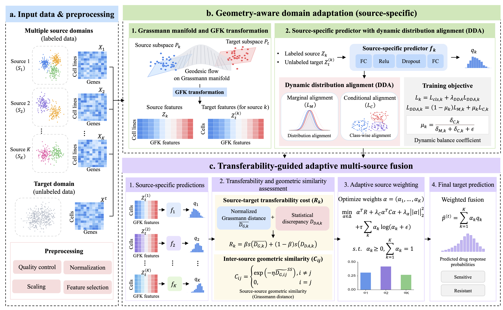

# GeoMDA: Geometry-aware multi-source domain adaptation for single-cell drug response prediction

GeoMDA transfers drug response knowledge from labeled bulk RNA-seq source domains to an unlabeled scRNA-seq target domain. It combines Grassmann manifold geometry and geodesic flow kernel (GFK) representations with dynamic distribution alignment (DDA), then fuses source-specific predictions using transferability-guided source weights.




## Installation Guide
- Clone the repository:
  ```
  git clone https://github.com/BMBDM/GeoMDA.git
  cd GeoMDA
  ```
- Install the dependencies:
  ```
  pip install -r requirements.txt
  ```
- Optionally, install the toolkit as an importable Python package:
  ```
  pip install .
  ```

## Usage Example

For the 2-source geometry and DDA sweep:

```bash
nohup env CUDA_VISIBLE_DEVICES=1 python experiments/run_multisource_gfk_dda_optimized_tp4k.py \
  --tasks experiments/tasks_tp4k.csv \
  --n-sources 2 \
  --source-split-seed 0 \
  --sampling smote \
  --dims 5,10,15,20,30,50 \
  --lambdas 0,0.01,0.1,0.5,1,2 \
  --seeds 0,1,2,3,4,5,6,7,8,9 \
  --epochs 100 \
  --beta 0.5 \
  --lambda-c 0.1 \
  --lambda-alpha 0 \
  --taus 0,0.01,0.03,0.05,0.1 \
  --eta 1 \
  --outdir results_2src_smote_tp4k \
 > results_2src_smote_tp4k.log 2>&1 &
```

Use `--help` with a runner to see all options. 

